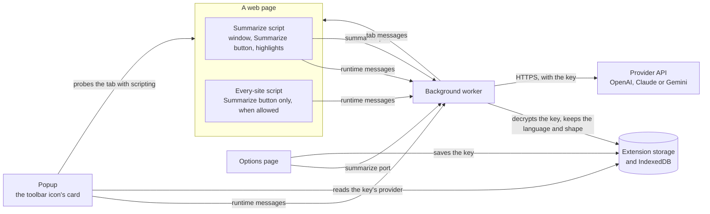

# Architecture

Dr. Too Long is a Manifest V3 extension built with [WXT](https://wxt.dev) and Preact, in a pnpm monorepo: `apps/extension` holds the extension and `packages/shared` the code its parts share. The one rule that shapes the layout: only the background worker reads the API key and calls a provider. The scripts that run inside web pages never touch the key, the storage or the provider APIs.

## The parts

Once a key is saved, the popup checks the page with a function it runs in the tab with `scripting`: whether the selection holds any text, how many words it holds, counted inside the page with `Intl.Segmenter`, whether an embedded frame has the focus, and whether the Summarize button is there. The function returns the count and yes-or-no answers, never the text. A page that does not answer within a second, held up by a dialog or a long task, leaves the card saying the page is busy. The worker accepts the popup's messages only from the popup page, and when the popup turns the Summarize button off or on for a site, it tells the tab's scripts with a tab message.

| Folder                                        | Runs in                    | Holds                                                                                                                                    |
| --------------------------------------------- | -------------------------- | ---------------------------------------------------------------------------------------------------------------------------------------- |
| `apps/extension/src/entrypoints`              | each part                  | WXT's entrypoints: the worker, the two content scripts, the popup and the options page, wiring only                                      |
| `apps/extension/src/background`               | the worker                 | the summarize port server, the message handler, starting a summary in a tab and the every-site registration                              |
| `apps/extension/src/content`                  | web pages                  | the summary window, the Summarize button, reading the selection, the highlights and the page's color scheme                              |
| `apps/extension/src/popup`                    | the popup                  | the toolbar icon's card: Summarize selection with the selected word count, the every-site switch, the per-site switch and the key status |
| `apps/extension/src/options`                  | the options page           | the API key alone: saving, testing, replacing and removing it                                                                            |
| `apps/extension/src/settings`                 | the worker, popup, options | the encrypted key, the summary language and the last shape in extension storage                                                          |
| `apps/extension/src/ui`                       | every part but the worker  | the colors and font for light and dark, the language picker's styles and following Chrome's theme                                        |
| `apps/extension/src` (files at the root)      | any part                   | what several parts use: the message types, the port client, the language list and picker, the every-site hook and the error messages     |
| `packages/shared/src/contracts`               | every part                 | the request and event types and schemas that cross the summarize port, and the shapes                                                    |
| `packages/shared/src/model`                   | the worker                 | the provider models, the prompt, output validation, error mapping and the stall timer                                                    |
| `packages/shared/src/providers`               | every part                 | each provider's name, API host, key page and key prefixes                                                                                |
| `packages/shared/src/segmentation`, `/limits` | content scripts            | sentence splitting and the 10,000-character cap                                                                                          |

## What may import what

- Content scripts never import `settings`, `background`, `options`, `popup`, WXT's storage, `@dr-too-long/shared/model` or `@dr-too-long/shared/providers`. A Biome rule enforces it for every file under `src/content` and `src/ui`, the content entrypoints and the root files, and `pnpm check:bundle` scans every built content script for the key, storage and provider hosts.
- The options page and the popup never import `@dr-too-long/shared/model` or `readApiKey`. The options page tests a key through the worker's summarize port, like the summary window, and the popup reads only which provider the saved key is for.
- The worker is the only caller of a provider. In production builds the manifest's `connect-src` allows fetches only to the three provider APIs.

## How a summary runs

1. The popup's Summarize selection button, the shortcut's `summarize` command, the menu item or the every-site script's Summarize button reaches the worker, which inserts the highlight style and runs the summarize script in the tab. Once that script runs, its own Summarize button opens the next window itself.
2. The script reads the selection's visible text, splits it into sentences and refuses an empty, editable, framed or over-long selection with a window that says so.
3. The summary window opens in the browser's top layer, where the Popover API keeps it above everything the page draws, as it does the Summarize button. The window asks the worker for a summary over the summarize port: the shape, the output language and the sentences, numbered.
4. The worker checks the request, decrypts the key and calls the provider through the AI SDK. It streams partial points, then the validated summary or an error, back over the port, and closes it.
5. Clicking a point finds its cited sentences on the page and highlights them with the CSS Custom Highlight API, which adds nothing to the page's DOM.

## What is stored

| Where                    | Key                  | What                                                                                                   |
| ------------------------ | -------------------- | ------------------------------------------------------------------------------------------------------ |
| `chrome.storage.local`   | `apiKey`             | the key's provider, and the key encrypted with AES-GCM, with the provider sealed in as additional data |
| `chrome.storage.local`   | `outputLanguage`     | the summary language chosen in the summary window; absent for Auto                                     |
| `chrome.storage.local`   | `shape`              | the shape used last                                                                                    |
| `chrome.storage.session` | `hiddenBubble:<tab>` | the hostnames where the Summarize button is turned off in that tab, in memory only                     |
| IndexedDB `dr-too-long`  | `keys` / `api-key`   | the non-extractable AES-GCM key that encrypts the API key                                              |

Selected text, summaries and page addresses are never stored. [PRIVACY.md](PRIVACY.md) says the same for readers.

## Checks

`pnpm verify` runs, as CI does: the dependency audit, Biome, TypeScript, the unit tests, the build, `check:manifest` (the whole manifest against `manifest-expected.json`, and the license files), `check:bundle`, and `pnpm smoke`, which loads the build into headless Chrome and fails on any error or DevTools issue from the worker, the options page or the popup.
