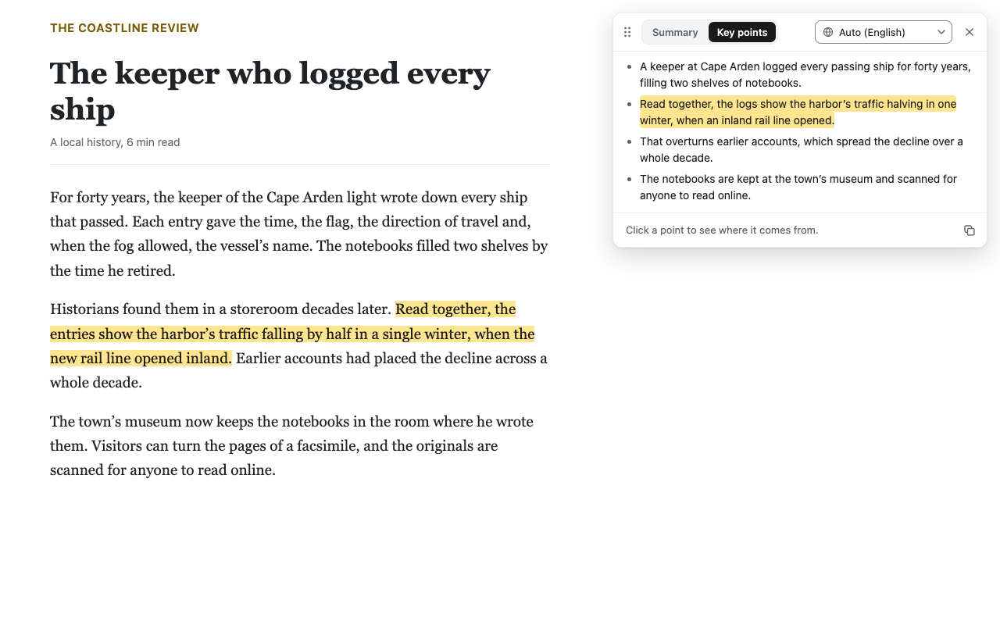

<p align="center">
  
</p>

<h1 align="center">Dr. Too Long</h1>

<p align="center">
  Summarize selected text in your language, with every point linked to its source.<br>
  Runs on your own OpenAI, Claude or Gemini API key.
</p>

<p align="center">
  <a href="https://github.com/sametpolat7/dr-too-long/actions/workflows/ci.yml"></a>
</p>



Select the part of a page you are unsure about and Dr. Too Long tells you what it says, in a window beside the text, so you can decide whether the whole thing is worth reading. Click a point and the page highlights the sentences it comes from, so you can check it against the source.

**Status:** in development, not yet on the Chrome Web Store.

## What it does

- **Two shapes.** **Summary** is one paragraph that opens with the bottom line. **Key points** lists what is worth keeping, most valuable first. Both fit the text: a sentence or two for a short passage, more for a long one.
- **Points you can check.** Each point cites the sentences it rests on. Clicking it highlights them on the page, and scrolls to the first when it is out of view.
- **Your language.** Summaries are written in Chrome's language, or in any of 47 languages you pick in the summary window.
- **Nothing in between.** The extension has no server and no account. The text you select goes from your browser to the provider you chose, and nowhere else.

## Install

The Chrome Web Store listing is on its way. Until then, build it from source as [Development](#development) explains and load it unpacked.

## Set up your key

Dr. Too Long is free. You pay only your provider for what you use, under your own account; a summary costs under a cent with any of them.

1. Create an API key with one provider. Make a key for Dr. Too Long alone, with a monthly spending limit.

   | Provider | Where to create a key                                                                                            | Model                   |
   | -------- | ---------------------------------------------------------------------------------------------------------------- | ----------------------- |
   | OpenAI   | [platform.openai.com/settings/organization/api-keys](https://platform.openai.com/settings/organization/api-keys) | `gpt-6-luna`            |
   | Claude   | [platform.claude.com/settings/keys](https://platform.claude.com/settings/keys)                                   | `claude-haiku-5-5`      |
   | Gemini   | [aistudio.google.com/apikey](https://aistudio.google.com/apikey)                                                 | `gemini-3.5-flash-lite` |

   Each is that provider's cheapest capable model, fixed in code: you choose the provider, not the model.

2. The options page opens when you install the extension. Later, click the toolbar icon, then **Set up**, or **Settings** once a key is saved. Pick your provider, paste the key, tick the box that says where your text goes, and click **Save key**.
3. Click **Test key**. A short sample summary streams in, and the page says "All set: your key works."

The options page holds only your key. One key is saved at a time: **Replace key** swaps it for a new one, from the same provider or another, and **Remove key** deletes it.

## Use

1. Select a few paragraphs on a web page.
2. Press <kbd>Ctrl</kbd>+<kbd>Shift</kbd>+<kbd>S</kbd> (<kbd>Command</kbd>+<kbd>Shift</kbd>+<kbd>S</kbd> on a Mac), right-click the selection and choose **Summarize “…”**, or click the toolbar icon, then **Summarize selection**.
3. The summary window opens at the top right and the summary streams in. In its top bar, switch between **Summary** and **Key points**, or rewrite the summary in another language with the field beside them: type in it to find one. Next time, the window opens on the shape and language you used last. Drag the bar, or the grip at its left, to move the window.
4. Click a point to highlight its sentences on the page. The copy button at the bottom right copies the summary; the window's icons name what they do when you hover over them.
5. Press <kbd>Escape</kbd>, click **×** or click the page to close the window and clear the highlight.

After a first summary on a page, selecting more text there brings up a yellow **Summarize** button right where you let go of the mouse, which summarizes at once. It stays with the text when you scroll, and hides while the text is behind a sticky header or scrolled out of sight inside a panel. To get the button on every site, tick **Show a Summarize button when I select text, on every site** in the toolbar icon's card.

The toolbar icon opens a small card. Its **Summarize selection** button says about how many words you selected, or why it cannot run, and the line below it names your shortcut. The card also holds the every-site switch and **Turn off on this site**, which hides the Summarize button on that site until the tab closes. Its foot shows which provider's key is saved and links to **Settings**, the options page.

## Good to know

- A selection can hold up to 10,000 characters. A longer one gets a window that says so.
- Chrome never lets extensions run on `chrome://` pages, the Chrome Web Store or its PDF viewer. There the toolbar icon's card says so, and the shortcut shows a `!` badge on the icon for a moment.
- Text in form fields, editors and embedded frames cannot be summarized.
- If another extension already uses the shortcut, set one at `chrome://extensions/shortcuts`.
- An empty balance or a reached spending limit shows as "out of credit or at its spending limit"; check your provider's billing settings.

## Privacy and permissions

The text you select goes to your provider only when you start a summary, and the extension keeps none of it: no selected text, summaries or page addresses are stored. Your key is encrypted on your device and is sent only to your provider. The [privacy policy](PRIVACY.md) lists every piece of data, where it goes and how long it is kept, and links each provider's terms.

The extension asks Chrome for:

- `activeTab` and `scripting`, to read the selection on the page where you use the toolbar icon, the shortcut or the menu item, and, once a key is saved, for the icon's card to count the words selected there, see whether the Summarize button is there and which site the tab is on. The card gets the count, never the words;
- `contextMenus`, for the menu item;
- `storage`, for your encrypted key, provider, summary language and shape, and, in memory until the tab closes, the sites where you turned the Summarize button off;
- access to `api.openai.com`, `api.anthropic.com` and `generativelanguage.googleapis.com`, the three provider APIs. Only the one for your key is called, and a security policy blocks requests to any other address.

It reaches no other site until you use it there, or until you tick the every-site option, which asks Chrome for access to all `https` sites; you can withdraw it at any time.

Dr. Too Long is an independent project. It is not affiliated with or endorsed by OpenAI, Anthropic or Google.

## Development

Requires Node 24 and pnpm 12.

```sh
pnpm install
pnpm build
```

Open `chrome://extensions`, turn on **Developer mode**, click **Load unpacked** and choose `apps/extension/.output/chrome-mv3`. After each rebuild, click the extension's **Reload** button. For live reload, run `pnpm dev` and load `apps/extension/.output/chrome-mv3-dev` instead.

| Command               | What it does                                                                                                                     |
| --------------------- | -------------------------------------------------------------------------------------------------------------------------------- |
| `pnpm dev`            | Builds the extension in watch mode with live reload                                                                              |
| `pnpm build`          | Production build into `apps/extension/.output/chrome-mv3`                                                                        |
| `pnpm zip`            | Zips the production build for the Chrome Web Store                                                                               |
| `pnpm lint`           | Checks formatting and lint rules with Biome                                                                                      |
| `pnpm format`         | Applies Biome formatting and safe fixes                                                                                          |
| `pnpm typecheck`      | Type-checks every package                                                                                                        |
| `pnpm test`           | Runs the unit tests of every package                                                                                             |
| `pnpm coverage`       | Runs the unit tests with a coverage report per file                                                                              |
| `pnpm check:manifest` | Fails if the built manifest differs from `manifest-expected.json` in any field but the version, or the license files are missing |
| `pnpm check:bundle`   | Fails if any built content script carries key, storage or provider code                                                          |
| `pnpm smoke`          | Loads the build into the installed Chrome, headless, and fails on any worker, options page or popup error                        |
| `pnpm verify`         | Runs what CI runs: the audit, lint, types, tests, the build, both build checks and the smoke test                                |
| `pnpm icons`          | Renders the PNG icons from `apps/extension/design`; needs `rsvg-convert` from librsvg                                            |

[ARCHITECTURE.md](ARCHITECTURE.md) explains how the parts fit together, and [the "no" list](docs/no-list.md) names what the project leaves out on purpose. `apps/evals` waits for a contributor to rebuild the summary-quality evals; see [its README](apps/evals/README.md).

## Contributing

See [CONTRIBUTING.md](CONTRIBUTING.md). Report a security flaw privately, as [SECURITY.md](SECURITY.md) explains. Everyone taking part follows the [code of conduct](CODE_OF_CONDUCT.md).

## License

[MIT](LICENSE). The packages the extension bundles are listed, with their licenses, in the `THIRD-PARTY-NOTICES.txt` that each build writes.
